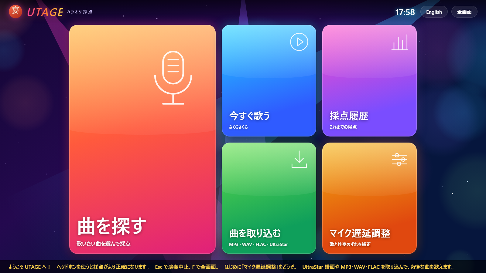
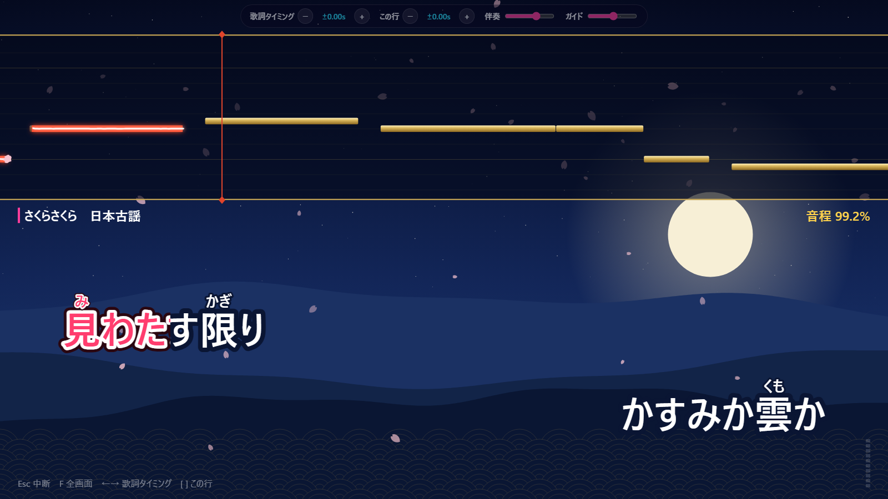
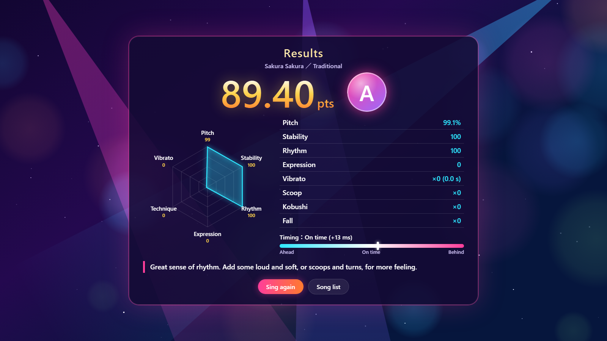
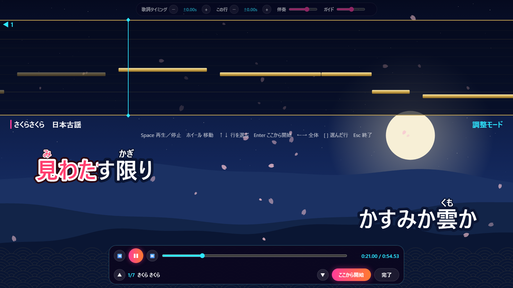

# 宴 UTAGE — karaoke scoring for Windows

UTAGE is a karaoke app with live pitch scoring, styled like a Japanese karaoke room. Sing into your microphone and it tracks your pitch against the melody, detects vibrato, しゃくり (scoops), こぶし and フォール (falls), and scores you out of 100 with a breakdown chart.

It runs as a small Windows app (`UTAGE.exe`) that opens in its own Microsoft Edge window. There's no installer and no build step for the app itself. Optional GPU vocal separation turns any song you own into a proper karaoke track.

| Home | Singing |
|---|---|
|  |  |
| **Results** | **Adjust mode** |
|  |  |

## Features

- **Live scoring**: YIN pitch tracking at ~90 frames/s, with an octave-tolerant comparison against the chart.
  - Ratings for 音程 (pitch), 安定性 (stability), リズム (rhythm) and 表現力 (expression).
  - Detection of vibrato, しゃくり, こぶし and フォール.
  - A total score, a rank and a hexagon chart, plus score history.
- **Your own songs**:
  - [UltraStar](https://usdx.eu/format) charts (`.txt`, UTF-8 or Shift_JIS) with MP3, WAV, FLAC or video.
  - Audio only: UTAGE finds the melody and adds timed lyrics from [LRCLIB](https://lrclib.net) or a `.lrc` file.
- **Furigana** is added automatically to imported lyrics, using a bundled offline dictionary (kuromoji). Readings also set how many notes each word gets.
- **Vocal separation (optional, GPU)**: Hybrid Demucs splits the voice from the music.
  - The melody is found from the voice alone.
  - You get a real instrumental backing track.
- **Video backgrounds**: MP4 or WebM files play behind the lyrics, kept in sync with the music.
- **Lyrics timing editor**:
  - Pause, scroll and scrub through a song, pick a line and click **Start here**, or tap Enter as each line begins.
  - Fixes are saved per song.
- **Mic latency calibration**, a guide melody, music and guide volume controls, and full screen.
- **Japanese and English interface**.

## Requirements

- Windows 10 or 11 with Microsoft Edge.
- A microphone. Headphones are strongly recommended so the mic doesn't pick up the music.
- Optional, for vocal separation: Python 3.11 and an NVIDIA GPU. It also works on the CPU, slowly.
- Optional, for tests: Node.js 20 or newer.

## Quick start

1. Build the launcher. The C# compiler ships with Windows:
   ```
   C:\Windows\Microsoft.NET\Framework64\v4.0.30319\csc.exe /nologo /target:winexe /win32icon:utage.ico /out:UTAGE.exe UTAGE.cs
   ```
2. Double-click `UTAGE.exe`. It serves this folder on `http://127.0.0.1:47913` and opens UTAGE in its own Edge window with its own profile. Your song library, history and mic permission live in `%LOCALAPPDATA%\Utage\edge`. Closing the window stops it.
3. Run **マイク遅延調整 / Mic latency** once, then sing the built-in demo, 「さくらさくら」 (a traditional song, public domain).

Keep `UTAGE.exe` in this folder, because it serves the files next to it.

## Optional: vocal separation

Without this step everything still works, using the built-in melody detector. That detector is reliable on vocal-only audio and rough on full mixes.

```
python -m venv C:\path\to\utage-venv
C:\path\to\utage-venv\Scripts\python.exe -m pip install torch==2.5.1 torchaudio==2.5.1 --index-url https://download.pytorch.org/whl/cu124
C:\path\to\utage-venv\Scripts\python.exe -m pip install soundfile numpy
```

Then put the path of that `python.exe` (one line) in `tools\python-path.txt`. On first use the model, torchaudio's `HDEMUCS_HIGH_MUSDB_PLUS`, is downloaded from download.pytorch.org. After that a song takes about 15–25 s on a mid-range GPU. Songs added before setup are separated the first time you open them.

For CPU-only PyTorch, drop the `--index-url` part.

## Adding songs (曲を取り込む)

- **UltraStar chart + audio or video**: pick both files together. The `#MP3`, `#VIDEO` and `#VIDEOGAP` tags are honoured.
- **Audio or video only**: UTAGE finds the melody (from the separated voice when available), then lyrics come from:
  - a `.lrc` file with the same name, picked together with the audio, or
  - an LRCLIB search, prefilled from file names like `Artist - Title.mp3`. Versions closest to your file's length are listed first.
  - Or none, in which case every note shows 「ら」.
- **Video and audio with the same name**: the sound comes from the audio file and the picture from the video.
- **Lyrics markup in charts**: `見{み}` adds furigana, and a `~` syllable holds the previous one (melisma).

Please use music you own.

## While singing

| Key | Action |
|---|---|
| ← / → (Shift: fine) | Shift all lyrics earlier / later |
| [ / ] | Shift the current line |
| Space | Pause → adjust mode (that run isn't scored) |
| F | Full screen |
| Esc | Stop |

**Adjust mode** (✎ next to a song):
- Space plays and pauses, and the mouse wheel scrolls through the song.
- ↑↓ pick a line, and **Enter / Start here** snaps it to the current position. The lines after it move along.
- All timing fixes are saved to the song.
- On charts UTAGE built from audio, timing fixes move only the lyrics. The detected melody stays where it is in the recording.

## Scoring

| Item | How |
|---|---|
| 音程 Pitch | Per-frame closeness to the note: full credit within ±0.5 semitone, none past ±1.25, weighted by note length |
| リズム Rhythm | Arrival time at each note after a rest or pitch change; full credit within ±60 ms. The average gives early / on time / late |
| 安定性 Stability | Spread of held notes, ignoring attack, release and vibrato |
| 表現力 Expression | Loudness range plus how often techniques appear |
| Vibrato | Regular 4–8.5 Hz wobble of ≥0.15 semitone lasting ≥0.35 s |
| しゃくり Scoop | The note starts ≥0.7 semitone low and rises onto it within 0.4 s |
| こぶし Kobushi | A brief (≤0.3 s) excursion of ≥0.6 semitone inside a held note that comes back |
| フォール Fall | Pitch drops ≥1.5 semitones at the end of a note before a rest |

Total = 70% pitch + 10% stability + 10% rhythm + 5% expression + up to 5 bonus points for techniques. Ranks: 秀 S ≥90, 優 A ≥80, 良 B ≥70, 可 C ≥60, otherwise 練 D.

## Development

```
node --test tests/
```

The tests synthesize singing with known mistakes and ornaments and check the scorer. They also cover UltraStar and LRC parsing, furigana, lyric fitting, timing fixes, WAV encoding and video sync.

Preview screens without a mic, from `index.html` or the running app:
- `?preview=play&t=21`
- `?preview=play&mode=edit&t=21`
- `?preview=result`
- `?preview=songs`
- Add `&lang=en` for English.

| Path | What |
|---|---|
| `core.js` | Scoring, pitch tracking, charts, lyrics, synthesis (no DOM; also loaded by the tests) |
| `app.js` | Screens, audio I/O, stage drawing, import, editor |
| `index.html` | Layout and styles |
| `UTAGE.cs` | The launcher: local file server plus `/api/separate` for vocal separation |
| `tools/separate.py` | Hybrid Demucs separation run by the launcher |
| `vendor/kuromoji/` | Japanese morphological analyzer and dictionary for furigana |
| `tests/` | Node tests |

## Credits

- [kuromoji.js](https://github.com/takuyaa/kuromoji.js) with its bundled IPADIC dictionary is included in `vendor/kuromoji` under the Apache License 2.0. See `vendor/kuromoji/LICENSE-2.0.txt` and `NOTICE.md`.
- Hybrid Demucs weights come from [torchaudio](https://pytorch.org/audio/stable/generated/torchaudio.pipelines.HDEMUCS_HIGH_MUSDB_PLUS.html) and are downloaded at runtime, not included here.
- Lyrics are fetched by the user from [LRCLIB](https://lrclib.net), a community lyrics database, and are not included here.
- The visual design is original. UTAGE isn't affiliated with any karaoke company.

## License

[MIT](LICENSE). Bundled third-party code in `vendor/` keeps its own licence (Apache-2.0).
